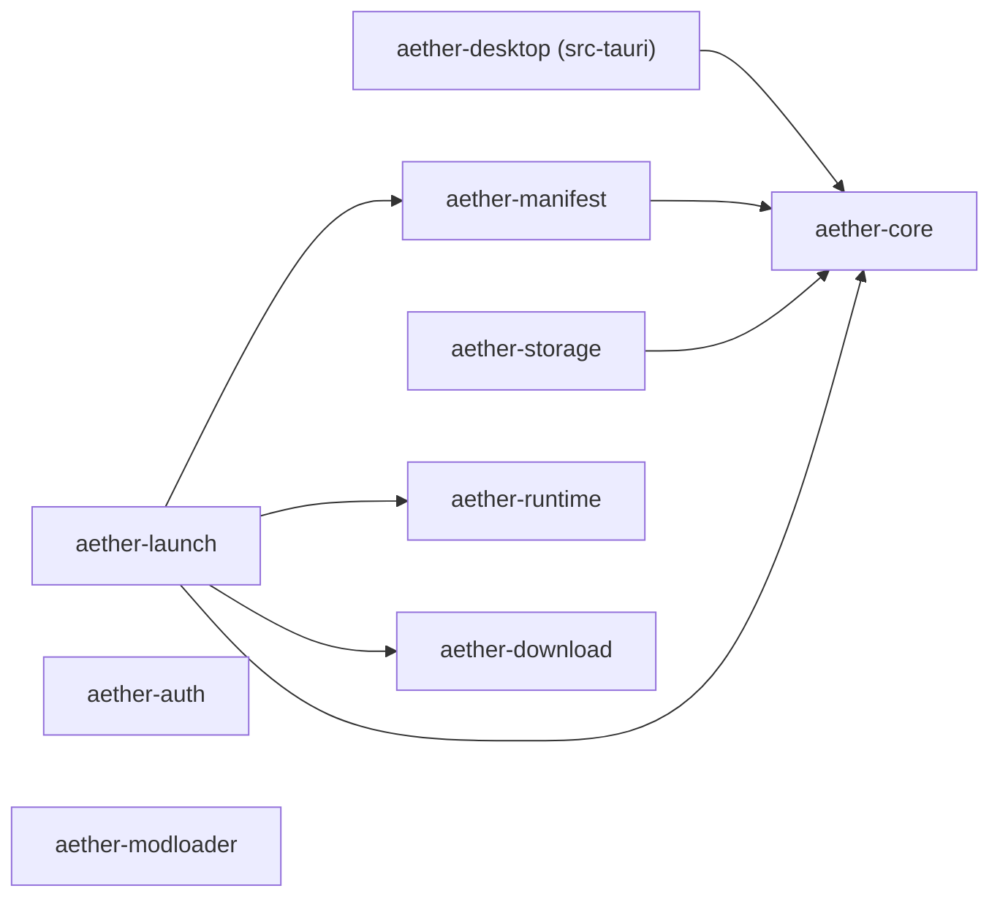

# 架构概览

Aether Launcher 分两层：Rust workspace 放领域逻辑，React 前端放界面，中间由 Tauri 2 的 IPC 连接。

```text
React + Fluent UI  ──(Tauri IPC)──  src-tauri (aether-desktop)  ──  crates/*
```

## Crate 依赖



`aether-core` 在最底层，只放实例和版本的基础类型。`download`、`auth`、`modloader`、`runtime` 目前互不依赖，也不依赖 core。

## Crate 一览

| Crate | 职责 | 现有内容 |
| --- | --- | --- |
| `aether-core` | 实例与版本的领域模型 | `InstanceId`（UUID v4）、`VersionId`（拒绝空串）、`InstanceState`（ready / incomplete / running / failed）、`GameInstance` |
| `aether-manifest` | Minecraft 版本元数据 | `parse_version_manifest` → `VersionManifest`（`id`、`inheritsFrom`、`mainClass`、`assetIndex`、`downloads.client`、`javaVersion`、`libraries`、`arguments` / `minecraftArguments`）；`rules`（`Rule`、`Environment`、`rules_allow`）；`arguments`（`expand_arguments`）；`merge_with_parent`（继承合并），`load_version_manifest`（从本地磁盘安全加载完整继承链） |
| `aether-download` | 下载计划与校验 | `ArtifactSource`、`DownloadArtifact`、`DownloadPlan::validate`；`native_zip::preflight_native_zip` 验证 ZIP 条目名称、文件类型、重复目标和解压大小限制 |
| `aether-auth` | 账户模型 | `AccountId`、`AccountKind`（Microsoft / Offline）、`AccountProfile` |
| `aether-runtime` | Java 运行时 | `JavaRuntime`、`supports`；跨平台检测 PATH / JAVA_HOME / 常见安装目录和 Minecraft runtime，探测 Java 版本、架构与厂商 |
| `aether-launch` | 启动请求与计划 | `LaunchRequest`、`LaunchPlan`；`select_java_runtime` 选 Java；`build_launch_plan` 组装 JVM / classpath / 游戏参数；`build_native_plan` 选择 native JAR 并输出下载计划；`build_install_plan` 从已校验的版本 JSON 生成客户端 JAR、Libraries 和 native 压缩包的下载计划；`GameProcess` 监督子进程并捕获有界日志；`InstanceProcessRegistry` 按实例 ID 管理进程；`InstanceLaunchCoordinator` 从可信实例文件准备启动并校验客户端 JAR |
| `aether-modloader` | 模组加载器 | `ModLoaderKind`（Fabric / Forge / NeoForge / Quilt）、`ModLoaderVersion` |
| `aether-storage` | 本地持久化 | `encode_instance` / `decode_instance`、`InstanceStore::load`（从受管理的 UUID 目录读取和验证实例） |
| `aether-schematic` | 投影图解码 | 极简 NBT 读取器（gzip + 全标签、解压与深度上限）；`.litematic` 元数据与 Litematica 位打包解码，按预览上限（单区域/总量 8M 方块、调色板 65536）拒绝超限文件；数据版本 → 正式版对照表 |

按现有类型推断，启动一次游戏时的分工是：`manifest` 解析版本，`download` 生成并校验下载计划，`runtime` 选 Java，`launch` 组装启动计划，`storage` 保存实例。目前还没有代码把它们串起来。

## 前端结构

```text
src/
├── main.tsx          入口
├── App.tsx           外壳：主题、侧边栏、页面切换
├── navigation.tsx    页面清单（id、名称、图标、说明）
├── components/       Sidebar、PageHeader、PendingPanel（「尚未实现」提示）
├── pages/            HomePage、SettingsPage；功能未做的页面共用 PlaceholderPage
├── ipc/              对后端命令的类型化封装
└── lib/              纯函数与小 hook（问候语、配色方案）
```

没有路由库，页面切换就是 `App` 里的一个 state。

配色方案有深色、浅色、跟随系统三种，默认深色。选择保存在 `localStorage` 的 `aether.theme`。`App` 把解析后的结果同时交给 Fluent 的 `FluentProvider`（组件配色）和 `.app-shell` 的 `data-theme`（`App.css` 里的颜色变量）。新增样式时颜色走 `App.css` 顶部的变量，不要写死色值。

## IPC 边界

- 前端只通过 `src/ipc/` 调用后端，组件里不直接 `invoke`。
- 命令在 `src-tauri/src/lib.rs` 里用 `#[tauri::command]` 定义，并列进 `generate_handler!`。当前命令：应用信息、Java 发现、版本目录与原版安装（`catalog` / `vanilla` / `install`）、实例（`instances`）、从现有启动器导入（`import`）、启动控制（`launch`），以及投影图管理（`schematics`：自动扫描每个实例 `schematics/` 目录并按实例分组返回，读取、导入、删除、跨实例复制都只收实例 ID 与裸文件名）。
- 窗口权限在 `src-tauri/capabilities/default.json`，目前只有 `core:default`。这个目录在 CODEOWNERS 里单独列出。
- 命令是窄化的领域操作（导入这个实例、启动这个实例），参数用类型表达。不提供执行任意命令、读写任意路径的入口。

新增一个命令：

1. 逻辑放在对应 crate 里并写测试，`src-tauri` 里的命令只负责转换参数和结果。
2. 在 `src-tauri/src/lib.rs` 里添加命令函数，并加入 `generate_handler!`。
3. 需要新权限时修改 `capabilities/`。
4. 在 `src/ipc/index.ts` 的 `CommandResults` 里登记命令名和返回类型，再加一个封装函数和测试。

`call` 目前只支持无参数命令，第一个带参数的命令出现时一起扩展。

Java 发现命令 `list_java_runtimes` 是只读且无参数的 IPC：Tauri 使用 `spawn_blocking` 调用 `aether_runtime::discover_java_runtimes`，避免阻塞窗口线程。返回字段统一采用 camelCase（`executable`、`majorVersion`、`architecture`、`vendor`），未识别到安装时返回空数组；任务内部失败则返回错误。前端仅通过 `src/ipc/index.ts` 的 `listJavaRuntimes()` 调用。该命令不会接受来自前端的任意可执行文件路径。

## 版本继承

`VersionManifest::merge_with_parent` 把子版本（Fabric、Forge 等）叠加到已经解析好的父版本上。多级继承由调用方从最顶层的父版本开始逐级合并。

- 库：子版本在前、父版本在后。group、artifact、classifier 和规则都相同的库只留一个，版本更高的赢，版本相同留子版本的。规则不同的同名库都保留（比如各平台的 natives）。名字不是 Maven 坐标的库不参与去重。
- 参数：父版本在前、子版本在后。
- 其他字段：子版本有就用子版本的，没有就用父版本的。
- 版本按段比较：数字按数值比，`1.0` 大于 `1.0-beta`，`1.0` 等于 `1.0.0`。

库顺序、参数顺序和「新版本优先」参考了 HMCL v3.17.0.362 的合并行为，只参考行为，没有复制代码。

`aether_manifest::load_version_manifest(game_directory, version_id)` 从 `versions/<id>/<id>.json` 加载当前版本，沿 `inheritsFrom` 从父级到子级逐层合并，最终保留子版本 ID。所有版本必须在本机存在；找不到父版本会返回错误。入口拒绝路径分隔符和 Windows 特殊设备名，并验证规范化后的文件路径属于 `versions/` 目录；循环继承和超过 32 层的继承都会拒绝，单个 JSON 有 8 MiB 大小上限。调用者需显式提供已信任的游戏目录，此 API 不暴露可传入任意路径的 Tauri IPC。

`aether_launch::select_java_runtime` 根据解析结果中的 `javaVersion.majorVersion` 在已发现的 Java 运行时中匹配完全相同的主版本，返回首个匹配实例；没有需求、找不到匹配或主版本超出 `u16` 范围都以明确错误返回。旧版未提供 `javaVersion` 时暂不猜测 Java 8。


## 启动计划组装（现代版本）

`aether_launch::build_launch_plan(request, manifest, runtime, environment, options)` 将已解析的 `VersionManifest` 与已发现的 Java 运行时组装为 `LaunchPlan`（`runtime`、`working_directory`、按 argv 顺序排列的 `arguments`）。调用方需提供 `LaunchOptions`：游戏数据目录、工作目录、已下载的 **实际客户端 JAR**、已准备好的 natives 目录及认证/用户参数变量。继承版可能复用原版客户端 JAR，因此不能根据子版本的 `id` 猜测 JAR 文件位置。

- 先验证内存、Java 主版本与 `mainClass`；仅支持有 `arguments` 的现代版本。旧版 `minecraftArguments` 暂不自动拆词。
- 按当前系统和 features 的规则过滤 library。优先使用 `downloads.artifact.path`，否则由 Maven 坐标生成本地 `libraries` 相对路径；验证路径安全、存在性，并拒绝链接到 `libraries` 目录之外的库文件。
- classpath 按清单库顺序追加实际客户端 JAR，使用运行系统对应的路径分隔符。展开条件参数及 `${...}` 占位符；缺失变量明确报错，非递归展开；若 JVM 参数没有显式 `-cp` 则补齐。
- 不走 Shell，不执行 Java；认证变量可能包含访问令牌，不要记录或持久化完整 argv。
- natives 下载计划、已下载 JAR 的校验/安全提取和已安装目录的复核已实现；HTTP 下载、旧版参数仍待实现。独立 `natives-*` classifier JAR 由协调器准备后不进入 JVM classpath。

## Natives 下载计划与解包安全边界

清单的 `libraries[].downloads.classifiers`、`natives` 和 `extract.exclude` 已能反序列化。调用 `aether_launch::build_native_plan(manifest, environment)` 按操作系统、CPU 架构和库 rules 生成 `NativePlan`，其 `download_plan()` 复用已有的 `DownloadPlan::validate`。支持旧版 `natives-windows-${arch}` 的 32/64 位替换与现代 `group:artifact:version:natives-windows` 这样的独立分类器。元数据缺失时明确返回错误，不猜测不可靠的下载地址。

`aether_download::native_zip::preflight_native_zip` 是解包前的纯校验接口。它检查 ZIP 条目名称、路径穿越、Windows 保留名、重复输出、符号链接/特殊类型，并对条目数量（16384）、单文件未压缩大小（256 MiB）和全包未压缩总量（512 MiB）设限。排除规则（如 `META-INF/`）只能跳过已通过路径校验的条目。

**现已支持本地安装 natives：** `aether_download::verify::verify_local_artifact` 流式校验已有文件的大小与 SHA-1，拒绝链接到游戏根目录之外的文件；`aether_download::native_install::install_native_archives` 会先预检查所有 ZIP 条目，在同一文件系统上创建私有临时目录、使用 `create_new` 流式解压，并重新检查实际解压字节数。全部成功后只通过目录 rename 发布，失败时清理临时目录，已有的正式 natives 目录不被正常流程覆盖。上层使用 `NativePlan::install(game_directory, natives_directory)` 调用。

**安全及使用边界：** 此接口不下载文件，也不会调用带历史安全漏洞的 `ZipArchive::extract`。调用方必须保证游戏根目录没有不受信任进程并发篡改，并提供全新的、位于游戏根目录内的 natives 目录。ZIP 库升级至 9.0.5 以避开已公开的解压漏洞，对应 Rust MSRV 从 1.85 提升到 1.88。SHA-1 用于与 Mojang 清单核验文件内容，不视为抗恶意碰撞的签名机制。当前 `build_launch_plan` 会略过显式 native classifier 的 classpath 条目；调用方必须先确认所需 natives 已安全准备。

## 游戏进程管理（Rust 内部 API）

`aether_launch::GameProcess::spawn(&launch_plan, extra_redactions)` 直接执行已有的 `LaunchPlan`，不经过 shell。启动前检查 Java 可执行文件是已存在的绝对路径（并规范化路径）、工作目录已存在；stdin 关闭，stdout 和 stderr 各由独立线程读取，以免输出管道阻塞 Java 进程。进程可通过 `id()` 查看 PID，`try_wait()` 非阻塞查询退出状态，`wait()` 等待退出并收尾，`stop()` 强制结束**主进程**。丢弃运行中的句柄时也会尝试结束其主进程。

`drain_logs()` 非阻塞读取缓存日志，单条日志最多 8 KiB，缓冲队列上限 256 条；生产者遇到队列已满时丢弃日志、不阻塞进程输出，并通过 `discarded_logs()` 统计丢弃数。会脱敏常见 `--accessToken` / `--clientToken` 等参数对应的值，也支持显式提供其他脱敏词；**不得把完整 `LaunchPlan.arguments` 写入常规日志，或者把原始游戏输出当成无敏感信息的安全数据**。日志脱敏是尽力而为，额外凭据必须由调用方声明。

当前进程管理**只向 Rust 内部暴露**，没有提供允许前端自定义任意命令、路径或 argv 的 Tauri IPC。进程强制停止不能保证结束 Java 生成的全部子进程；`wait()` 在子进程后代继承标准输出句柄时也可能继续等待读线程。仍需实现实例级进程注册、受控启动入口、优雅停止及游戏退出事件，才能向 UI 开放。

## 按实例管理游戏进程

新增 `aether_launch::InstanceProcessRegistry`。它是 Rust 内部的内存注册表，用 `aether_core::InstanceId` 作为键，维护已启动游戏进程及其状态；调用方必须使用已验证、可信的 `LaunchPlan`，**不能把用户提供的任意 executable / argv 转发给注册表**。

- `start(instance_id, plan, redactions)` 阻止同一实例被重复启动；不同实例可并行运行。对于已经正常退出或手动停止的实例，允许重新启动。
- `status(instance_id)` 和 `list()` 使用非阻塞 `try_wait` 更新状态，公开 `Running`、`Exited`（退出码为成功）、`Stopped`（用户停止）和 `Failed`（自然异常退出）。`InstanceRunState::instance_state()` 将这些状态对应到已有 `InstanceState`：Running → Running，Exited/Stopped → Ready，Failed → Failed；不会覆盖磁盘中的实例信息。
- `drain_logs(instance_id)` 仅消费该实例已脱敏的有界 stdout/stderr 日志；`discarded_logs` 记录队列满时丢弃的日志数。查询状态不会主动删除末尾日志。
- `stop(instance_id)` 只结束该实例注册的主进程。重复停止、自然退出后的停止保持幂等，不会影响其他实例。
- `forget_finished(instance_id)` 只能清理已结束的实例，拒绝静默删除正在运行的进程；清理或重新启动会丢弃旧日志。注册表被销毁时，`GameProcess` 的析构行为会尝试结束尚在运行的主进程。

该注册表的方法要求可变引用（`&mut self`），供后端所有者序列化访问；目前**没有向 Tauri 暴露状态、启动或停止 IPC**。后续应先实现可信的实例目录加载与启动计划准备，再以仅接受已注册实例 ID 的有限域命令接入 UI；同时补充长期保留日志、后台状态轮询、进程树清理及优雅退出能力。

## 可信实例读取与启动协调（Rust 内部）

新增 `aether_storage::InstanceStore`，由后端指定 **受管理的存储根目录**，按 `instances/<UUID>/instance.json` 读取实例，不接受调用方给出的任意路径。它会限制实例记录的大小（128 KiB）、拒绝符号链接记录和跳转目录，检查 JSON 中的实例 UUID 与请求一致，且工作目录必须是该 UUID 对应的实例目录。`InstanceId` 现实现 `Display`，序列化后的 UUID 可直接用作目录名。

`aether_manifest::load_resolved_version_manifest` 在多级 `inheritsFrom` 合并时额外记录 `downloads.client` 来自哪个版本。不能把 Fabric 子版本的 `id` 误当作实际客户端 JAR 文件名。

`aether_launch::InstanceLaunchCoordinator` 将上述读取与 `JavaRuntime` 选择、客户端 JAR 本地大小/SHA-1 核验、`build_launch_plan` 和 `InstanceProcessRegistry` 串联。后端拥有可信 `instance_storage_root` 与 `game_directory`，`prepare(instance_id, memory_mib, runtimes, environment, account_variables)` 只从 UUID 加载受管理实例，不接受前端传入可执行路径、Java argv、客户端 JAR 路径或工作目录。对受信任的账户上下文可以用 `start` 启动准备好的计划；`status/list/drain_logs/stop/forget_finished` 将操作限定在已注册实例的进程句柄上。

**当前是受限协调器，不是完整 Minecraft 启动器。** 若 natives 缺失，协调器只在明确调用安装路径时提取已下载的档案；声明的 `assetIndex` 必须先通过真实文件的逐项校验，否则直接失败。只允许已经安装且能够验证客户端 JAR 的现代、资源要求完整满足当前条件的实例。未实现通用下载、微软账户验证、完整资产校验与 natives 自动安装的端到端编排。这些能力齐备之前，**不开放实例启动的 Tauri IPC**。受管理的存储根目录须为仅被可信启动器进程修改的目录，防止并发文件替换的竞态风险。

## 已安装 assets 与 natives 的启动前校验

`aether_download::assets::verify_installed_assets(game_directory, index_id, sha1, size)` 对 **已有的** `assets/indexes/<id>.json` 进行大小/SHA-1 核验，解析 `objects` 中的哈希与大小，并逐一校验 `assets/objects/<前两位>/<sha1>`。不使用逻辑资源名组装文件路径。索引最大 32 MiB、最多 250000 个对象、单文件最大 1 GiB；对象 hash 必须是 40 位十六进制，重复 hash 的声明大小必须一致。缺失、大小不符或 SHA-1 不匹配均会阻止启动。校验不联网，也不创建或修复文件。资源索引中的虚拟目录重映射尚未实现。

`NativePlan::verify_installed(game_directory, natives_directory)` 会验证来源 JAR 完整性，重复执行安全预检查，对照 ZIP 原始内容逐字节核验已解包的 native 文件，拒绝损坏、缺失、额外文件或符号链接。已存在的 natives 目录不因“目录存在”而默认可信。`InstanceLaunchCoordinator::prepare` 保持只读：如需 natives 而目录尚未安装，则返回 `NativesNotReady`。`prepare_and_install` 只会在目标不存在时将**已经下载**的 native JAR 安全解包到 `<game_directory>/natives/<实例UUID>`，并重新校验安装结果；如果已有目录被篡改，返回错误而不擅自覆盖。 `start` 使用这一准备路径，然后才启动 Java 进程。Native classifier JAR 仅用于提取，不进入 JVM classpath。

**仍待实现：** Mojang HTTP 下载与下载缓存回填、资源对象修复、legacy `virtual/legacy` assets、完整身份认证、运行时 Java 自动安装、模组加载器适配，以及进程组优雅关闭。当前接口仅供受信任 Rust 调用，假设游戏数据目录没有不受信任进程同时修改。未向 Tauri 提供任意命令或任意路径执行能力。

## 从现有启动器导入实例

`aether-storage::import` 分三层，任何一层都不复制游戏文件。支持的启动器按磁盘布局分成两类：

| 启动器 | 强标记 | 版本元数据 |
| --- | --- | --- |
| PCL2 | `PCL/Setup.ini`、`PCL.ini`、根目录 `Setup.ini` | `versions/<id>/<id>.json` |
| HMCL | `.hmcl.json`、`hmcl.json`、`hmclversion.cfg` | `versions/<id>/<id>.json` |
| BakaXL | `BakaXL.exe`、`BakaXL.Core*`、`BakaXL.Plugin` | `versions/<id>/<id>.json`（含 `.minecraft/` 一层） |
| Prism / MultiMC | `prismlauncher.cfg`、`multimc.cfg` | 没有；`instances/<id>/mmc-pack.json` 描述版本 |
| 普通游戏文件夹 | 无 | `versions/<id>/<id>.json` |

前三个把游戏放在 `.minecraft` 里，所以一条流水线导入；Prism / MultiMC 用组件格式描述版本，走第二条入口。

- `detect` / `plan_candidates` 是纯函数：输入是目录快照 `ExistingFiles`，输出每个版本的导入计划。检测顺序是 Prism → PCL2 → HMCL → BakaXL：Prism 目录里也有 `.minecraft` 形状的树，先判它才不会被当成普通游戏文件夹。都没有时按普通游戏文件夹处理（`ImportSourceKind::Folder`）。
- `scan_game_directory` 把真实游戏目录变成快照。它**不遍历整棵树**：真实的 `.minecraft` 光 `libraries/` 和 `assets/` 就有几千个文件，整树扫描会撞上 4096 条目上限。它只收集根目录条目（启动器标记）和 `versions/<id>/<id>.json`（含根下 `.minecraft/` 一层），跳过符号链接，条目上限同样是 4096。`scan_directory` 保留给需要整树快照的调用方。
- `import_versions(source_root, game_root, base, ids)` 执行导入：读取 `versions/<id>/<id>.json` 及其 `inheritsFrom` 祖先（深度上限 32、单个文件 8 MiB），把每个 JSON 发布到 `game_root/versions/<id>/`，再为每个版本创建一个实例，**实例记录绑定到 `game_root` 本身**。`game_root` 就是用户自己的 `.minecraft`，`source_root` 通常也是它（从文件夹导入时两者相同），所以导入是把版本登记进同一个目录，不是搬一份。
- **同名版本不覆盖**：`versions/<id>/<id>.json` 已存在时返回 `DuplicateName`，界面把它列成「已存在」提示，那个版本（可能是官方校验过的、也可能是别的启动器装的）原样保留。继承链上的父版本已存在不算冲突：原版 JSON 早就在同一个 `.minecraft` 里是常态。
- `import_prism_instances(launcher_root, game_root, base, ids)` 只创建实例，不复制任何文件。Prism 的 `meta/` 是它自己的组件格式，不是 Mojang 版本 JSON，所以实例按 `mmc-pack.json` 里的 `net.minecraft` 组件版本创建；每个实例绑定到它自己的 `instances/<id>/.minecraft`。加载器组件（Fabric / Quilt / Forge / NeoForge / LiteLoader）读出来只用于展示，不安装。实例名取自 `instance.cfg` 的 `name=`，不接受调用方传入。

客户端 JAR、依赖库、资源和 natives 不复制。它们由 `install_vanilla_client_libraries(id, version)` 按清单下载并校验，**装进该实例记录的游戏目录**（也就是那个 `.minecraft`），官方源失败时回退 BMCLAPI 镜像。Prism 实例没有版本 JSON，所以前端会先调 `cache_vanilla_version_manifest` 把官方清单缓存进同一个游戏目录，再补齐文件。

### 导入的 IPC 边界

前端从不传路径，四个命令都在后端完成选择与扫描：

| 命令 | 作用 |
| --- | --- |
| `pick_import_folder` | 后端用 `tauri-plugin-dialog` 打开系统文件夹选择框，扫描用户选中的目录并返回预览 |
| `detect_launcher_installations` | 在有限范围内查找 PCL2 / HMCL / BakaXL / Prism / MultiMC，读取配置里记录的游戏目录或实例 |
| `pick_launcher_folder` | 手动指定启动器目录或 `.minecraft` 目录，用于自动查找失败的情况 |
| `import_versions` | 只接收预览返回的 `token` 和勾选的条目 ID |

扫描结果保存在后端 `ImportState` 里，用一次性 token 引用；token 用过即失效，前端既拿不到源目录也无法伪造一个。`ImportState` 存的是 `PendingSource` 枚举（`GameDirectory` / `PrismLauncher`），所以一个 token 不会被送进错误的导入流水线。写入目标始终是应用自己的实例存储和游戏目录。

PCL2 的 `Setup.ini` 用 `:` 分隔（PCL2 自己的写入器拒绝含 `:` 的键名），手改过的文件可能是 `=`，所以两种都认，取先出现的那个分隔符——这样 `LaunchFolderSelect:E:\mc` 和 `LaunchArgumentTitle:foo=bar` 都能正确切分。

配置位置有三种：`<目录>/PCL/Setup.ini`（文档布局）、`<目录>/PCL.ini`（旧版平铺），以及 `<目录>/Setup.ini`——后者要么是改包的启动器把文件放在根目录，要么是用户直接选中了 `PCL` 配置文件夹本身。选中 `PCL` 文件夹时，只有当配置里出现 `$` 相对路径、且父目录能解析出带 `versions/` 的游戏目录，才把父目录当作启动器目录；绝对路径不受影响。任意目录里一个不像 PCL2 的 `Setup.ini` 会被拒绝，避免把普通安装器目录当成启动器。

PCL2 把启动器自身目录写成 `$`，所以 `$\.minecraft` 表示 `<PCL2 目录>\.minecraft`，含 `..` 的值直接拒绝。PCL2 通常把自定义文件夹列表放在注册表，因此 `LaunchFolders` 只在 `Setup.ini` 里出现时才作为补充读取。

Prism / MultiMC 的 `InstanceDir=` 默认是 `instances`，配置里可以改成别的相对路径；只有存在配置文件（`prism::has_config`）的目录才算启动器，光有一个 `instances/` 子目录不算。`mmc-pack.json` 上限 1 MiB，`instance.cfg` 和启动器配置上限 256 KiB。

自动查找是有限搜索：`app.path()` 解析出的真实桌面 / 下载 / 文档目录（Windows 常被重定向到 OneDrive 或别的盘，所以不能用 `%USERPROFILE%\Desktop`）、用户主目录，以及每个固定盘的顶层，合计最多检查 1500 个目录、最多报告 8 个启动器。每个目录按 PCL2 → Prism → HMCL → BakaXL 的顺序认一次：启动器目录标记优先于游戏目录标记，因为一个启动器目录里可能还留着别的启动器写过的 `.minecraft`。找不到就退回手动选择，不做全盘遍历。

## 投影图（`.litematic`）

`.minecraft` 是**所有启动器共用的一份**：Aether 直接读它，也直接往里下载，从不复制、不搬位置。私有目录（`%APPDATA%\app.aetherlauncher.desktop`）只放实例记录 `instances/<uuid>/instance.json` 这类小型配置文件，和 PCL 的 `PCL/` 文件夹是同一定位。

投影图跟着实例走：每个实例游戏目录下的 `schematics/` 就是它的投影库。扫描和整理都在 `src-tauri/src/commands/schematics.rs`，解码在 `aether-schematic`。

- **`.litematic` 的真实布局**：根上是 `Version`、`SubVersion`、`MinecraftDataVersion`、`Metadata` 复合和 `Regions` 复合。名称、作者、`RegionCount`、`TotalBlocks`、`TotalVolume`、`EnclosingSize` 都在 `Metadata` 里，计数是 `TAG_Int`（也接受 `TAG_Long`）。每个区域的调色板是 `BlockStatePalette`——一个方块状态列表，索引就是列表下标；预览只取其中的 `Name`，`Properties` 不参与上色。
- **保留文件夹结构**：扫描是递归的（深度上限 8、条目上限 4096、跳过符号链接），每个文件用 `relativePath`（`/` 分隔，如 `城堡/主楼.litematic`）标识。前端 `src/lib/schematicTree.ts` 据此还原目录树，文件夹可折叠。
- **三处来源，但版本目录只认自己那个**：一个实例能看到 ——
  - 实例私有的 `<实例目录>/schematics`；
  - 游戏目录根上的 `<游戏目录>/schematics`（不启用版本隔离的启动器放这里，所有版本共用）；
  - **自己那个版本**的 `<游戏目录>/versions/<版本>/schematics`。

  第三条只认实例记录里的 `version`，**不能把 `versions/` 下所有版本的 `schematics` 都算进来**：那样每个版本都会显示整个 `.minecraft` 的投影总和（本机 134 个实例全部显示 1649 个，界面上就是「每个版本都有 1000 多个」）。投影跟着版本走，`versions/生电-1.21.4/schematics` 只属于生电那个版本。实测 134 个实例里只有 7 个真有投影：生电 785、互通服务器 773、XPlus 75、1.10.2 74、服务器1 13、服务器2 2、彗星汉化 1。
- **名字为空或 `Unnamed` 时回退到文件名**：很多投影的作者只填作者和方块数，`Metadata.Name` 留着 Litematica 的占位值 `Unnamed`。`display_name` 把空白和 `Unnamed`（大小写不敏感）都当成没填名字，用文件名去掉 `.litematic` 后显示。
- **游戏目录只来自实例记录**：Aether 是独立启动器，不从 PCL2、HMCL 等别的启动器读配置，也不扫描磁盘猜路径。`GameInstance::game_directory` 是唯一来源，由后端在用户选目录时写入。老记录（这个字段加入之前创建的实例）没有它，因此扫不到任何东西；`list_schematics` 会报出 `missingGameDirectory` 数量，界面据此显示「设置游戏目录」入口，用户选一次后由 `apply_game_directory` 批量写回 —— 写前先把要改的 `instance.json` 备份到 `instances/.backup-<时间戳>/`，已经设置过的不动。
- **路径校验**：IPC 只接受 `schematics/` 下的相对路径。`validate_relative_path` 要求 `/` 分隔、以 `.litematic` 结尾、每段不超过 255 字节、总长不超过 1024、层级不超过 8，并通过 `aether_download::is_safe_relative_path`（拒绝 `..`、盘符、保留名、结尾点）。目标文件夹用 `validate_folder_path`，空字符串表示根目录。
- **列表页只读头部，而且并行读**：一个 `.litematic` 解压后可以有几 GB（本机 1723 个就是 5.78 GB），列表页却只要根上那几个标量。因此有三层减速措施，缺一层页面就像卡死：
  - `read_metadata_from` 直接从文件流解压，凑够 `Version` / `MinecraftDataVersion` / `Metadata` 就停，**不把整份文件读进内存**；
  - 遍历目录只收集待解析文件，解析交给线程池（最多 8 线程，少于 16 个文件时走串行，那时开线程反而更慢）；
  - 缓存必须落在**来源目录**这一层，而不是实例或游戏目录：`versions/<a>/schematics` 属于 a，`versions/<b>/schematics` 属于 b，能共享的只有「一个目录里有什么」。按游戏目录缓存整份结果，会让 134 个共用同一个 `.minecraft` 的实例全部显示同一份上千个投影。
  - `versions/` 的目录名另按游戏目录缓存：这一层只取决于游戏目录，否则 134 个实例会各枚举一遍。
  - 实测（134 个实例、1723 个文件、压缩后 101 MB）：来源枚举 816 ms → 1 ms，解析 1560 ms → 500 ms；实际遍历 159 个目录，133 个实例看到 1649 个、只有带额外同步目录的那一个看到 1723 个。
  - 前端同样不能一次渲染全部：一个版本的 `schematics/` 根上能有 778 个文件，文件夹默认折叠，根层每页 100 行。

| 命令 | 作用 |
| --- | --- |
| `list_schematics` | 递归扫描所有实例，只返回有投影的版本 |
| `read_schematic` | 完整解码一个投影，返回 3D 预览数据 |
| `import_schematic` | 前端读取用户选择的文件**内容**传进来，写进 `schematics/` 根目录，同名拒绝覆盖 |
| `import_schematic_folder` | 后端打开文件夹选择框，递归复制其中所有 `.litematic`，保留子文件夹，重名自动改名；解析失败的文件记进 `skipped` |
| `delete_schematic` | 删除一个投影 |
| `paste_schematic` | 复制或移动到目标版本的任意文件夹，返回新的相对路径 |

`paste_schematic` 同时覆盖「同版本内整理目录」和「跨版本共享」：源和目标可以是同一个实例。目标已有同名文件时自动改名成 `名字 (2).litematic`，不覆盖已有投影；`moveFile` 为真时写完再删源。写入一律先落 `.staging-*` 临时文件再原子改名，避免半截文件被当成可解析的投影。

前端一次只在一个版本里多选，避免跨版本批量操作的语义含糊；剪贴板记的是「相对路径 + 来源」（`origin` / `originVersion`），粘贴时才真正落盘。

**读、删、粘贴的源都按来源定位。** `read_schematic` / `delete_schematic` / `paste_schematic` 都接收 `origin` 与 `originVersion`，由 `resolve_existing_path` 换算成真实路径：`instance` → `<实例目录>/schematics`，`game` → `<游戏目录>/schematics`，`version` → `<游戏目录>/versions/<版本>/schematics`。只按相对路径拼到实例私有目录是错的 —— 文件实际在版本目录里，双击预览就会报 `cannot inspect schematic file`。`originVersion` 必须是单个安全路径段，未知的 `origin` 直接拒绝。**写入方向不受影响**：导入和粘贴的目标永远是实例私有目录，绝不改写共享的游戏目录。


## 投影图的贴图渲染

纯色方块看起来就是马赛克：木板没有纹理、楼梯是整块立方体、玻璃不透明。真实观感要用 Minecraft 自己的
`blockstates/*.json`、`models/**/*.json` 和 `textures/**/*.png` —— 它们都在玩家已经下载好的版本 jar 里。

**材质从哪来是一个保存的设置，提取才是按需的。** 一个客户端 jar 二十多 MB、上千个 model，
进页面就解压会每次等好几秒。所以分成两件事：

- **选择**：设置页的「投影图材质」选一个版本，选中即保存在本机。预览窗口读这个设置，
  自动套用；选「纯色预览」就退回纯色方块。
- **提取**：发生在第一次套用时，结果按 jar 缓存在应用数据目录，之后只读缓存。

提取在 `src-tauri/src/commands/schematics/asset_pack/`：

| 文件 | 职责 |
| --- | --- |
| `mod.rs` | `build_asset_pack`：读 jar（`MAX_ENTRIES = 40_000`、`MAX_JSON_BYTES`、`MAX_TEXTURE_BYTES`、`MAX_TEXTURES`），解析 blockstate 与模型，建图集后把四边形 UV 落进对应格子 |
| `model.rs` | `bake_all` / `resolve_model`：走父链合并模型，把 element 展开成带 UV 的四边形，按 `cullface` 记录可剔除方向，按方块名决定渲染层 |
| `pack.rs` | `build_atlas`：每张 16×16 贴图放一个格子，交给解码器统一转换成 8 位 RGBA，输出一张 PNG 和每张图的 0..1 UV |
| `cache.rs` | 找版本 jar（优先与版本目录同名的那个，`MIN_LIBRARY_JAR_BYTES = 8 MiB` 过滤掉 loader 的小 jar）、缓存键与读写 |

- **缓存键 = jar 路径 + 大小 + 修改时间**，不用内容哈希 —— 算哈希要读 25 MB，换来的只是重装同版本时多命中一次。
  缓存在应用数据目录的 `asset-packs/<键>/` 下，包含 `pack.json` 与 `atlas.png`。
- **图集通过 data URL 交给前端**，不新开资源协议、不落临时文件：一张 512² 的图压完几十 KB，只读一次。
- **材质 id 带命名空间**（`minecraft:block/oak_planks`）。剥掉 `minecraft:` 前缀会让图集一张都找不到。

前端在 `src/lib/texturedMesh.ts`（纯函数，不依赖 Three）把投影方格和资源包合成几何：

- 每个方块按模型展开成若干四边形，楼梯就是 15 个面，不再是整立方体；
- 带 `cullface` 的面在邻居占住该方向时整面跳过，房子内墙不画；
- 按 `opaque` / `cutout` / `translucent` 分三层：`cutout` 用 `alphaTest`（树叶、铁栏杆），`translucent` 关
  `depthWrite`（玻璃）；
- 图集必须 `NearestFilter`，否则像素纹理被插值糊掉。

资源包里没有的方块退回纯色整方块（`fallback`），不会凭空消失；超过 `maxQuads`（40 万）就停止继续展开，避免把页面拖死。

两条踩过的坑，改这块前先看：

- **UV 必须乘上图集格子。** 烘焙阶段只能算出「这张贴图在这个面里占 0..1 的哪一段」，
  它不知道贴图落在图集第几格。漏掉 `apply_atlas_slots` 这一步，每个面都会采样整张图集，
  画面就是一片乱码。
- **PNG 解码要交给解码器做颜色转换。** 原版贴图大量是索引色，自己按 `ColorType` 取字节
  拿不到调色板，只会吐出洋红占位。

## 还没有的部分

- `aether-manifest` 能解析 libraries、arguments、assetIndex、`downloads.client` 和 `javaVersion`，并按规则过滤库、展开参数。还没有：`logging`，以及 `os.version` 的正则（带 `version` 的系统规则目前按不匹配处理）。
- `aether-download` 的 `DownloadPlan::validate` 检查来源非空、SHA-1 格式，以及 `destination` 是安全的相对路径：不含 `..`、盘符、Windows 保留名，`/` 和 `\` 都当作分隔符，大小写不敏感地不重复。下载和写盘本身还没有实现。
- `aether-runtime` 的 `JavaRuntime::supports` 要求主版本完全相等。Java 发现与探测已实现并通过只读 IPC 暴露，支持由 `aether-launch` 基于已解析清单匹配 Java 主版本，但还没有自动下载 Java、持久化首选运行时或启动进程。
- `aether-auth` 只有账户模型，没有 Microsoft / Xbox / Minecraft 登录流程，也没有凭据存储。
- `aether-storage` 只做 JSON 编解码，不读写磁盘。
- `aether-launch` 可以对现代版本生成启动计划，`NativePlan::install` 已能调用独立 natives 安装器，并增加了只接收后端 `LaunchPlan` 的 Java 进程监督 API；尚未整合为从实例一路启动游戏的完整流程。
- `aether-modloader` 目前只有类型。
